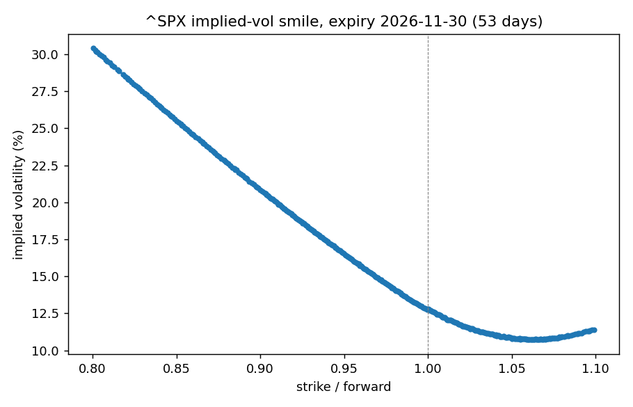
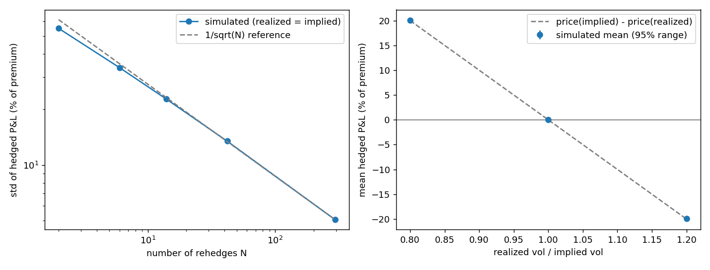

# Delta-hedging a short SPX option: pricing, implied-vol smile, and hedging error

Author: Mohammed Khan   Date: 10/08/2026   Python 3.9.6; see requirements.txt.

## Summary
I built a Black-76 pricing engine with Greeks, solved implied volatilities from a real SPX option chain, and simulated delta-hedging a
short at-the-money call. The simulation reproduces the key results: the average hedged P&L equals the option price at the implied vol minus the
price at the realized vol, whatever the hedging frequency; the spread of P&L shrinks like 1/sqrt(number of rehedges); and trading costs trade
off against that spread. On the real chain (2026-10-08, 53-day expiry) the ATM implied vol was 12.79% and the 10%-below-forward skew was +8.05 points.

## Question and hypotheses (fixed before any data was pulled; DECISIONS.md)
Does a delta-hedged short option's P&L track (implied vol - realized vol), and how do rehedging frequency and costs change it?
1. Mean hedged P&L is about premium x (implied - realized) / implied. 2. Its spread shrinks like 1 / sqrt(N). 3. Descriptive: the SPX smile.

## Method
- Pricing: Black-76 on the forward, with delta, gamma, vega, theta; nine tests including a hand-worked reference value, put-call parity, and every Greek checked against finite differences.
- Chain: one ^SPX snapshot (Yahoo, cached unedited). Cleaning rules fixed in advance. Forward and discount factor from put-call parity (window checked from 2% to 15%: ATM vol moves 0.08 points).
- Implied vol: Brent solver on out-of-the-money options only, 390 strikes, no failures.
- Simulation: driftless GBM forward, 10,000 paths, 294 steps over 42 trading days, rate 0. Realized vol 0.8x, 1.0x, 1.2x implied. Rehedge every 21, 7, 3, 1 days and 7 times a day. Costs 0, 1, 2 bp per trade. Same random numbers for every case.

## Results

- ATM implied vol (53 days): 12.79%
- Implied vol at 0.90 x forward: 20.84% (skew +8.05 points)
- Mean hedged P&L at 1.2x realized vol (% of premium): -19.9%
- Mean hedged P&L at 0.8x realized vol (% of premium): +20.0%
- Mean hedged P&L at 1.0x realized vol (% of premium): +0.07%
- Spread of hedged P&L, daily hedging (% of premium): 13.5%
- Spread of hedged P&L, 7 times a day (% of premium): 5.1% (ratio of daily to 7 times a day: 2.66)
- Cost at 1 bp per trade, 7 times a day (% of premium): 3.1%
- Mean hedged P&L after that cost (% of premium): -3.0%

## Predictions versus results (PREDICTIONS.md)
Two predictions about the real market missed narrowly (ATM vol 12.79% vs 13-25%; skew +8.05 vs +3 to +8). Six about the simulation came out
inside their ranges, but they were textbook approximations of what the simulation implements, so they validate the code, not my forecasting.

## Limitations
- Constant-volatility geometric Brownian motion: no smile dynamics, jumps, or stochastic vol. The "perfect hedge" is a property of the model.
- One chain snapshot on one day; the smile is a single day, not a pattern.
- Simulated maturity (42 trading days) differs from the chain's expiry (53 calendar days, about 37 trading days); only the ATM vol is used.
- Interest rate set to zero in the simulation; costs of 1-2 bp are assumed, not measured. Costs apply to hedge trades only.
- T uses calendar days / 365 and ignores the time of day (about 0.3%).
- Predictions were made with general knowledge of how markets behave, not independent forecasts.

## Data
The Yahoo Finance option chain is not redistributed here (data/ is git-ignored). To rerun, pull a chain into data/raw/ (python3 -m src.smile); a new pull is a different day's market and will not match these numbers.

## Reproduce
    python3 -m pip install -r requirements.txt
    python3 run_all.py     # needs the cached chain in data/raw and PREDICTIONS.md

## Layout
DECISIONS.md, PREDICTIONS.md, ASSUMPTIONS.md, src/ (pricing, implied_vol, chain, smile, hedging), scripts/, tests/, outputs/.